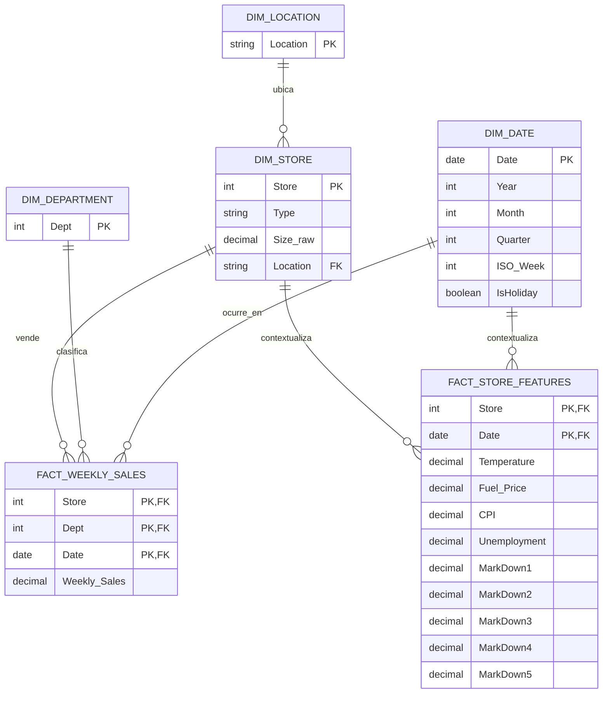

# Modelo entidad-relación

## Granularidad y relaciones

`FACT_WEEKLY_SALES` tiene una fila por tienda, departamento y semana (`Store + Dept + Date`). `FACT_STORE_FEATURES` tiene una fila por tienda y semana (`Store + Date`): son variables contextuales comunes a todos los departamentos de esa tienda y fecha. Mantenerlas en una tabla aparte evita duplicar sus valores al unirlas a ventas de muchos departamentos.

`DIM_STORE` contiene la ubicación observada en `sales.csv`, el tipo y el tamaño original. El tamaño se mantiene como `Size_raw` por la discrepancia de escala detectada frente a las unidades esperadas; confirmar la unidad antes de darle una interpretación. `DIM_LOCATION` puede derivarse como catálogo de ubicaciones distintas. La ubicación no aparece en `stores.csv`, por lo que fue recuperada de `sales.csv` y no es una dimensión independiente de fuente.

Las claves compuestas de ambas tablas de hechos se validan como únicas. `IsHoliday` se conserva en ambas fuentes para detectar desacuerdos; en una versión productiva debe provenir de un calendario de fechas validado.
